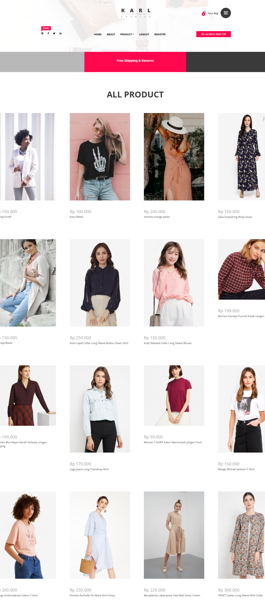
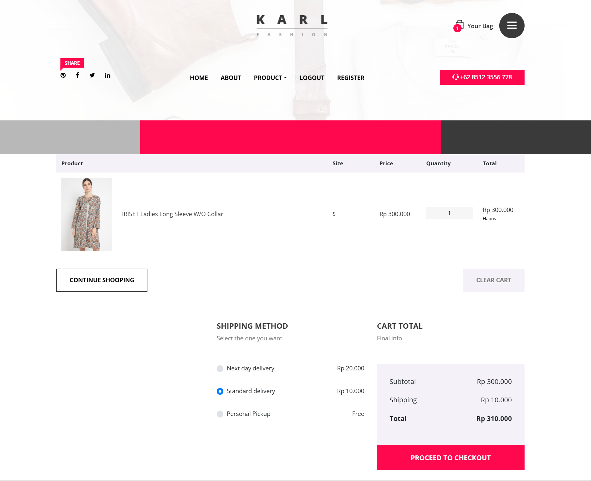
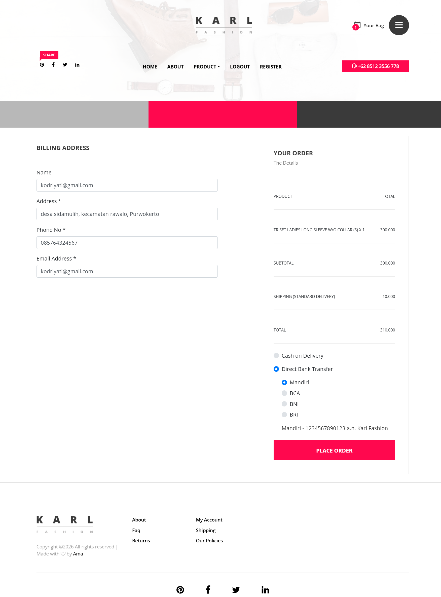
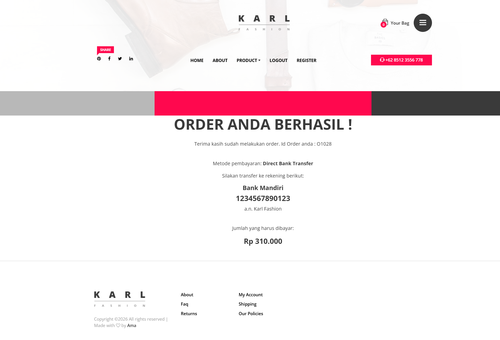

# Karl Store – Website E-Commerce Fashion

Karl Store merupakan website e-commerce sederhana yang dikembangkan untuk penjualan produk fashion secara online. Website ini menyediakan berbagai kategori produk, seperti pakaian, tas, aksesori, sepatu, dan sandal.

Pengguna dapat melihat katalog produk, memilih ukuran dan jumlah produk, menambahkan produk ke keranjang, melakukan checkout, serta mengelola informasi akun. Website ini juga dilengkapi dengan halaman administrator untuk mengelola produk dan kategori serta mengelola akun administrator dan member.

## Live Demo
**[Kunjungi Karl Store Fashion](https://karl-store.infinityfreeapp.com/)**

## Website Preview
## Website Preview

Berikut merupakan beberapa tampilan halaman utama dari **Karl Store**, mulai dari penjelajahan produk, proses pembelian, hingga pengelolaan akun pengguna.

### 1. Product Catalog
Halaman katalog menampilkan berbagai produk fashion yang tersedia di Karl Store, dilengkapi dengan gambar produk, nama, dan harga. Pengguna dapat menjelajahi koleksi produk yang tersedia.

<p align="center">
  
</p>

### 2. Product Detail
Halaman detail produk menampilkan informasi produk secara lengkap, meliputi gambar, nama, harga, ketersediaan stok, pilihan ukuran, dan kuantitas. Pengguna dapat memilih ukuran dan jumlah produk sebelum menambahkannya ke keranjang belanja.

<p align="center">
  
</p>

### 3. Shopping Cart
Halaman keranjang belanja menampilkan produk yang telah dipilih pengguna beserta ukuran, harga, dan kuantitas. Tersedia juga pilihan metode pengiriman serta perhitungan subtotal, biaya pengiriman, dan total pembayaran.

<p align="center">
  
</p>

### 4. Checkout
Halaman checkout menyediakan formulir alamat penagihan dan ringkasan pesanan. Pengguna dapat memeriksa kembali detail pembelian serta memilih metode pembayaran, seperti Cash on Delivery dan Direct Bank Transfer melalui beberapa pilihan bank.

<p align="center">
  
</p>

### 5. Order Confirmation
Halaman konfirmasi pesanan menampilkan informasi bahwa pesanan berhasil dibuat, termasuk ID pesanan, metode pembayaran, informasi rekening tujuan untuk pembayaran melalui transfer bank, dan jumlah pembayaran.

<p align="center">
  
</p>

### 6. My Account
Halaman My Account memungkinkan pengguna melihat dan memperbarui informasi profil, seperti email, nama, nomor telepon, dan alamat. Tersedia juga fitur perubahan password dengan verifikasi password lama.

<p align="center">
  
</p>

## Key Features

### 1. User Authentication
- User registration
- Login and logout
- Forgot password

### 2. Product Catalog
- Menampilkan daftar produk berdasarkan kategori.
- Menampilkan informasi produk, harga, dan gambar.
- Menyediakan navigasi kategori produk.

### 3. Product Detail
- Menampilkan detail produk, gambar, harga, dan stok.
- Memilih ukuran pakaian (S, M, L, XL).
- Memilih ukuran sepatu dan sandal (36–41).
- Mengatur jumlah produk yang akan dibeli.
- Menampilkan informasi pengiriman dan pengembalian produk.

### 4. Shopping Cart
- Menampilkan produk yang ditambahkan ke keranjang.
- Mengatur jumlah produk dan pilihan ukuran.
- Menghapus produk atau mengosongkan keranjang.
- Memilih metode pengiriman:
  - Next Day Delivery
  - Standard Delivery
  - Personal Pickup
- Menghitung subtotal, biaya pengiriman, dan total pembayaran.

### 5. Checkout
- Mengisi informasi billing, seperti nama, alamat, nomor telepon, dan email.
- Menampilkan ringkasan pesanan.
- Memilih metode pembayaran:
  - Cash on Delivery (COD)
  - Direct Bank Transfer
  - Mandiri
  - BCA
  - BNI
  - BRI
- Menampilkan total pembayaran sebelum pesanan dikonfirmasi.

### 6. Order Confirmation
- Menampilkan notifikasi keberhasilan pemesanan.
- Menampilkan nomor pesanan (Order ID).
- Menampilkan metode pembayaran dan informasi rekening apabila menggunakan transfer bank.
- Menampilkan jumlah pembayaran.

### 7. My Account
- Menampilkan informasi profil pengguna, seperti email, nama, nomor telepon, dan alamat.
- Mengubah informasi profil.
- Mengubah password dengan verifikasi password lama dan konfirmasi password baru.

### 8. Information Pages
- About
- FAQ
- Returns
- Shipping Information
- Our Policies

### 9. Admin Dashboard
- Admin login and logout.
- Menambahkan, melihat, mengubah, dan menghapus produk.
- Mengelola kategori produk.
- Mengelola informasi produk, termasuk harga, stok, dan status produk.

## Technologies Used

- **Backend:** PHP
- **Database:** MySQL
- **Frontend:** HTML5, CSS3, JavaScript, Bootstrap
- **Libraries:** jQuery
- **Development Tools:** XAMPP, phpMyAdmin
- **Version Control:** Git, GitHub

## Database

Website ini menggunakan MySQL sebagai sistem pengelolaan database untuk menyimpan dan mengelola data yang dibutuhkan dalam proses e-commerce, seperti data pengguna, produk, kategori, keranjang belanja, dan transaksi.

## Project Structure

```text
karl-store/
│
├── admin/                          # Admin dashboard
│   ├── css/                        # Admin stylesheets
│   ├── fonts/                      # Admin font assets
│   ├── images/                     # Admin interface images
│   ├── img/
│   │   ├── bg-img/                 # Background images
│   │   ├── core-img/               # Logo and favicon
│   │   └── product-img/            # Product images
│   ├── js/                         # Admin JavaScript files
│   │   └── jquery/
│   ├── addAdmin.php                # Add administrator
│   ├── addCategori.php             # Add category
│   ├── addMember.php               # Add member
│   ├── addProduct.php              # Add product
│   ├── admin.php                   # Admin page
│   ├── categori.php                # Category management
│   ├── dataAdmin.php               # Administrator data
│   ├── editCategori.php             # Edit category
│   ├── editMember.php               # Edit member
│   ├── editPengiriman.php           # Edit shipping information
│   ├── editProduct.php              # Edit product
│   ├── edit_admin.php               # Edit administrator
│   ├── footer.php
│   ├── header.php
│   ├── index.php                   # Admin dashboard
│   ├── koneksi.php                 # Admin database connection
│   ├── logout.php
│   ├── member.php                  # Member management
│   ├── menu.php
│   ├── myaccount.php               # Admin account
│   ├── ourpolicies.php
│   ├── pengiriman.php              # Shipping management
│   ├── product.php                 # Product management
│   ├── session.php
│   └── title.php
│
├── css/                            # Main website stylesheets
├── database/
│   └── snrm9427_ecommerce.sql      # MySQL database
├── fonts/                          # Font assets
├── img/
│   ├── bg-img/                     # Background images
│   ├── core-img/                   # Logo and favicon
│   └── product-img/                # Product images
├── js/                             # Main JavaScript files
│   └── jquery/
├── product/                        # Product image uploads
├── screenshots/
│   ├── product-catalog.png
│   ├── product-detail.png
│   ├── shopping-cart.png
│   ├── checkout.png
│   ├── order-confirmation.png
│   └── my-account.png
├── about.php                       # About page
├── accessories.php                 # Accessories category
├── bag.php                         # Bag page
├── bags.php                        # Bags category
├── cart.php                        # Shopping cart
├── cat.php                         # Category page
├── categories.php                  # Category navigation
├── checkout.php                    # Checkout page
├── detail_product.php              # Product detail
├── dresses.php                     # Dresses category
├── faq.php                         # FAQ page
├── footer.php                      # Website footer
├── forgetPassword.php              # Forgot password
├── header.php                      # Website header
├── highheel.php                    # High heels category
├── iklan.php                       # Advertisement section
├── index.php                       # Homepage
├── kaos.php                        # T-shirt category
├── kemeja.php                      # Shirt category
├── koneksi.php                     # Database connection
├── konfirmasiorder.php             # Order confirmation
├── login.php                       # User login
├── login2.php                      # Login-related page
├── logout.php                      # User logout
├── menu.php                        # Navigation menu
├── menu2.php
├── menu3.php
├── menu4.php
├── menu5.php
├── menu6.php
├── myaccount.php                   # User account
├── notifcart.php                   # Cart notification
├── ourpolicies.php                 # Store policies
├── product.php                     # Product listing
├── prosesOrder.php                 # Order processing
├── purses.php                      # Purses category
├── register.php                    # User registration
├── return.php                      # Return information
├── sandal.php                      # Sandals category
├── sepatu.php                      # Shoes category
├── session.php                     # Session management
├── shippinginfo.php                # Shipping information
├── shoes.php                       # Shoes category
├── style.css                       # Additional styles
├── title.php                       # Website title and metadata
├── vintage.php                     # Vintage category
├── womenwear.php                   # Women's clothing category
└── README.md                       # Project documentation
```

**Note:** Folder `css`, `fonts`, `img`, dan `js` berisi aset pendukung tampilan website. Folder `product` menyimpan gambar produk yang digunakan dalam katalog.

## Installation & Configuration

1. Clone repository ini:

   ```bash
   git clone https://github.com/snrahmawati9-pixel/karl-store.git
   ```

2. Pindahkan folder project ke direktori `htdocs` pada XAMPP.

3. Jalankan Apache dan MySQL melalui XAMPP Control Panel.

4. Buat database baru melalui phpMyAdmin.

5. Import file database yang tersedia di folder `database`.

6. Sesuaikan konfigurasi koneksi database pada file `koneksi.php`.

7. Buka website melalui browser:

   ```text
   http://localhost/karl-store/
   ```

## Project Development

Project ini dikembangkan sebagai sarana penerapan dan pengembangan keterampilan web development menggunakan PHP dan MySQL. Pengembangan mencakup implementasi fitur e-commerce, pengelolaan database, autentikasi pengguna, serta pengelolaan produk melalui halaman administrator.

## Author

**Rahmawati**

GitHub: https://github.com/snrahmawati9-pixel
